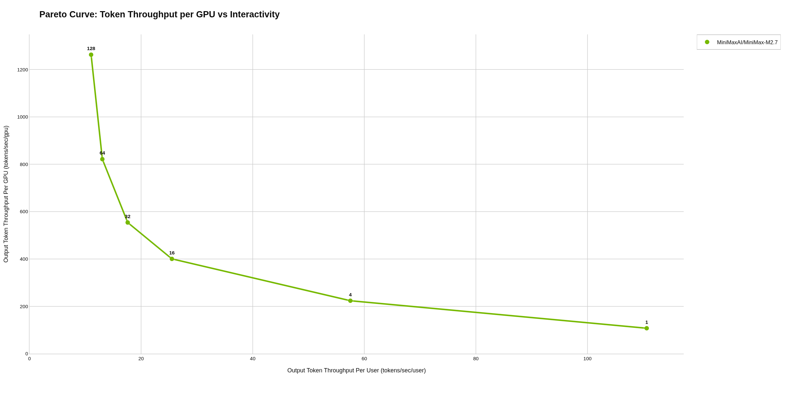
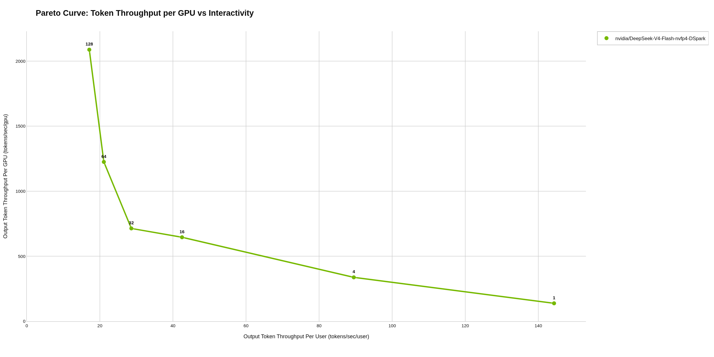
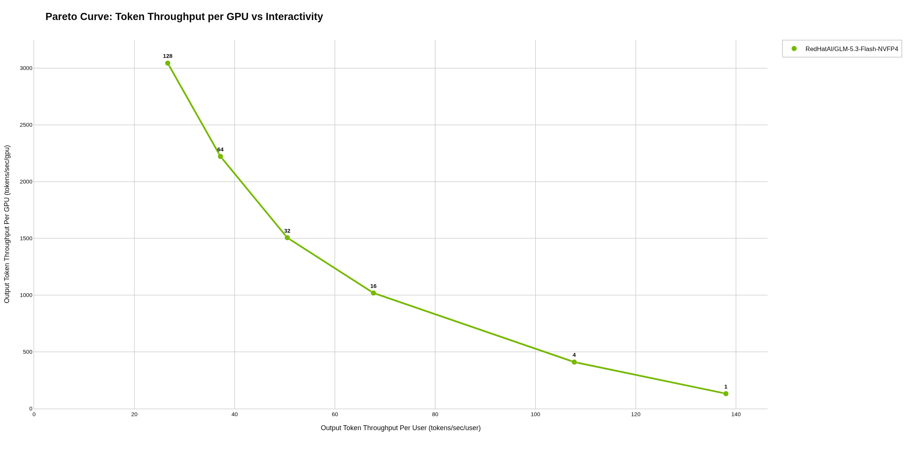
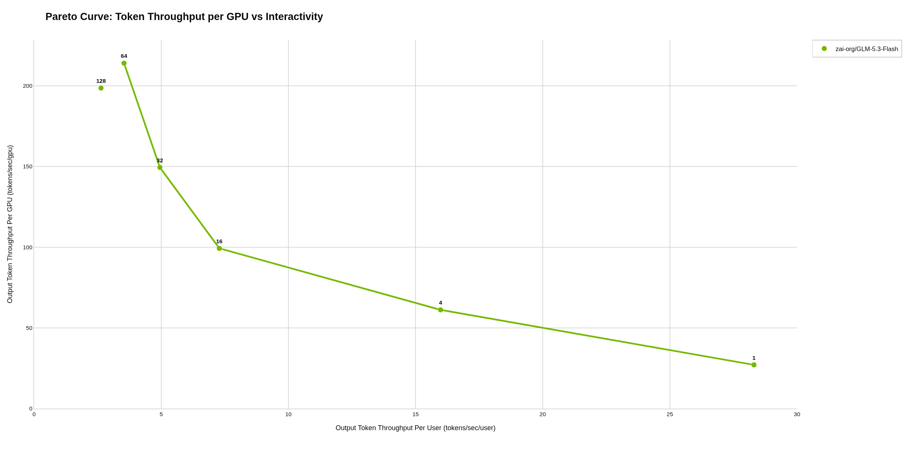
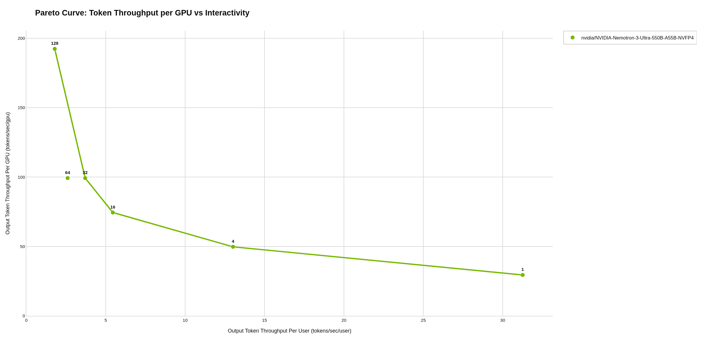

# aiperf_dgx_station_260919

Raw AIPerf benchmark results from a **second run on the NVIDIA DGX Station** (GB300),
2026-09-18 to 2026-09-19, re-testing the **5 largest MoE models at higher concurrency**
(up to 128).

This repo contains only this delta. The first run of all 20 models, including these 5 at
lower concurrency, is in
[aiperf_dgx_station_260918](https://github.com/mwolf-pi3g/aiperf_dgx_station_260918).

Generated with [aiperf_tool](https://github.com/mwolf-pi3g/aiperf_tool).
Analysis of these results can be found on our blog: https://pi3g.com/blog/

---

## Models tested

| Model | Concurrency levels | vLLM image |
|---|---|---|
| MiniMaxAI/MiniMax-M2.7 | 1, 4, 16, 32, 64, 128 | v0.29.0 |
| nvidia/DeepSeek-V4-Flash-nvfp4-DSpark | 1, 4, 16, 32, 64, 128 | v0.29.0 |
| RedHatAI/GLM-5.3-Flash-NVFP4 | 1, 4, 16, 32, 64, 128 | nightly |
| zai-org/GLM-5.3-Flash | 1, 4, 16, 32, 64, 128 | nightly |
| nvidia/NVIDIA-Nemotron-3-Ultra-550B-A55B-NVFP4 | 1, 4, 16, 32, 64, 128 | v0.22.0 |

---

## Changes versus run 1

| Model | Override changes |
|---|---|
| MiniMax-M2.7 | `--max-num-seqs` 64 → 128 |
| DeepSeek-V4-Flash | `--max-num-seqs` 64 → 128; added `--cpu-offload-gb 15 --cpu-offload-params experts`; added `--tool-call-parser deepseek_v4 --enable-auto-tool-choice` |
| GLM-5.3-Flash-NVFP4 | `--max-num-seqs` 64 → 128 |
| GLM-5.3-Flash | `--max-num-seqs` 64 → 128; `--cpu-offload-gb` 110 → 130 |
| Nemotron-3-Ultra-550B | `--max-num-seqs` 64 → 128 |

The concurrency sweep was extended to 128 for all five. Workload, base compose file, AIPerf
version and images are the same as in run 1.

---

## Test setup

- AIPerf 0.12.0
- 1024 input / 512 output tokens per request (fixed length, `ignore_eos:true`)
- 300 s per concurrency level, 2 profile runs per level, random seed 42
- Per-model vLLM flags in `conf/model_compose_overrides/`; per-model AIPerf inputs in
  `conf/big_models.json`

---

## Contents

| Path | Content |
|---|---|
| `artifacts/<timestamp>_<model>_c<levels>/` | One folder per model (5) |
| `…/aggregate/concurrency_<N>/profile_export_aiperf_aggregate.{json,csv}` | Aggregated metrics per concurrency level |
| `…/aggregate/sweep_aggregate/` | Metrics across the sweep |
| `…/profile_runs/trial_000N/` | Raw per-run AIPerf exports |
| `…/plots/` | Auto-generated plots and `summary.txt` |
| `conf/base_compose.yaml` | Shared Docker Compose base |
| `conf/model_compose_overrides/` | The 5 per-model vLLM overrides used in this run |
| `conf/big_models.json` | Model config (5 models) |
| `logs/` | `container_setup` logs of this run |
| `model_bringup.json` | Container start-to-ready times of this run |
| `app_versions.txt` | Installed packages on the Station (`apt list --installed`) |

---

## Notes

- The exact build of the `nightly` vLLM image was not recorded.
- Artifact folder timestamps use the Station's clock (8 h ahead of the UTC times in
  `model_bringup.json`).
- The model-level plots in `artifacts/<run>/plots/` were regenerated on 2026-10-26 with
  `aiperf plot` 0.12.0. The `aggregate/` files contain no GPU telemetry, so for plotting
  only, a copy of each aggregate file was given the telemetry block recorded in the
  matching `trial_0001` run (1 GPU). The data files in this repo are unchanged.

---

## Quick Takeaways

Pareto curve per model: output token throughput per GPU vs. per-user interactivity (generated by `aiperf plot`).

### MiniMaxAI/MiniMax-M2.7

### nvidia/DeepSeek-V4-Flash-nvfp4-DSpark

### RedHatAI/GLM-5.3-Flash-NVFP4

### zai-org/GLM-5.3-Flash

### nvidia/NVIDIA-Nemotron-3-Ultra-550B-A55B-NVFP4

